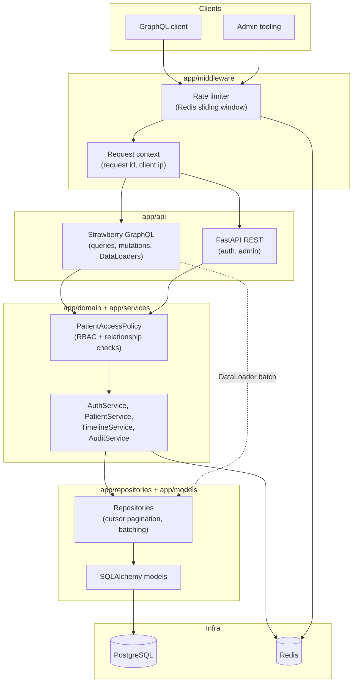
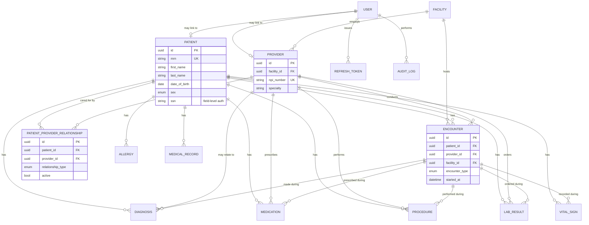

# Architecture

## Overview

HealthGraph is a layered backend: FastAPI hosts both a GraphQL API
(Strawberry) and a small REST surface for system administration, backed
by PostgreSQL through SQLAlchemy 2.0 (async) and Redis for caching and
rate limiting. The layering exists to keep one question answerable in
one place — "what SQL does this run" lives in repositories, "who's
allowed to see this" lives in the domain layer, and "what does the
client receive" lives in the API layer.



## Why this shape

**GraphQL and REST coexist on purpose.** GraphQL is the patient-data API
surface — it's where field-level authorization, DataLoader batching, and
query-cost limiting earn their keep, because clients ask for exactly the
shape of data they need across a relational graph. REST covers system
administration (user directory, facility directory, audit log) — flat,
infrequent, operational reads and writes that don't benefit from a query
language and are easier to reason about as fixed endpoints.

**The access policy is a separate layer from RBAC.** `app/auth` decides
*who someone is* (role, linked patient/provider id) from a JWT.
`app/domain/access_policy.py` decides *what they may touch*, and it's
deliberately not just a role check — a `DOCTOR` only sees a patient they
have an active `PatientProviderRelationship` with. Every patient-scoped
resolver calls into this one policy object rather than re-implementing
the check, so there's exactly one place that can be wrong.

**Repositories are the only code that writes SQL.** Services and
resolvers never touch `select()` directly. This is what makes the
DataLoader layer possible: `PatientScopedRepository.list_by_patient_ids`
is shared by every clinical entity (encounters, diagnoses, medications,
labs, procedures, vitals), so batching a new entity type into
`patientTimeline` is a five-line addition, not a new N+1 to discover
later.

**Audit writes use their own database connection.** `AuditService`
commits through a fresh session rather than the caller's, so a security
event — a failed login, an authorization denial — is recorded even if
the request that triggered it never reaches its own `commit()`. See the
docstring in `app/services/audit_service.py` for the full reasoning, and
`app/services/auth_service.py::register` for why that in turn means the
*acting* row (e.g. a newly created user) must be committed before it's
audited, not just flushed — the audit write is a different connection
and can't see an uncommitted transaction.

## Request lifecycle

1. **Rate limiting** (`app/middleware/rate_limit.py`) — a Redis
   sliding-window counter keyed by bearer token (or IP for anonymous
   traffic) rejects abusive callers before any handler runs.
2. **Request context** (`app/middleware/request_context.py`) — assigns a
   request id and captures the client IP into a `contextvar`, so
   structured logs and audit entries can be correlated without threading
   an id through every function signature.
3. **Auth resolution** — REST routes resolve the caller via a FastAPI
   dependency (`app/auth/dependencies.py`); GraphQL resolves it once per
   request into `GraphQLContext` (`app/api/graphql/context.py`), which
   also builds a fresh set of DataLoaders for that request only.
4. **Authorization** — role checks happen at the route/resolver
   boundary; patient-scoped access checks go through
   `PatientAccessPolicy`.
5. **Data access** — repositories run parameterized, indexed queries;
   patient-scoped ones use `PatientScopedRepository` for batched loads
   and keyset pagination.
6. **Response** — GraphQL types translate ORM rows (or, for the single-
   patient read path, a Redis-cached projection) into the schema shape.

## Entity-relationship diagram



See [migrations/versions/0b93bd8345a0_initial_schema.py](migrations/versions/0b93bd8345a0_initial_schema.py)
for the exact columns, constraints, and indexes.

## Directory layout

```
app/
├── api/
│   ├── graphql/       # Strawberry schema: types, queries, mutations, DataLoaders, context
│   └── rest/          # Auth + admin REST endpoints
├── auth/              # Password hashing, JWT issuing/verification, FastAPI auth dependencies
├── domain/            # CurrentUser, PatientAccessPolicy, input validators — no I/O
├── models/            # SQLAlchemy ORM models
├── repositories/       # All SQL: CRUD, cursor pagination, batched loads
├── services/           # Orchestration: AuthService, PatientService, TimelineService, AuditService
├── database/           # Engine/session setup, declarative base
├── cache/              # Redis client + cache-aside CacheService
├── middleware/          # Rate limiting, request context
└── main.py             # FastAPI app assembly

tests/
├── unit/         # Pure logic — no database or network
├── integration/  # Real Postgres + Redis, transactional rollback per test
└── e2e/          # Full HTTP-stack workflows spanning multiple mutations

migrations/       # Alembic revisions
scripts/          # seed.py (demo data), benchmark.py (N+1 vs batched)
```

## Performance and security

Covered in depth in [PERFORMANCE.md](PERFORMANCE.md) and
[SECURITY.md](SECURITY.md) respectively; the GraphQL schema itself is
documented in [API.md](API.md).
